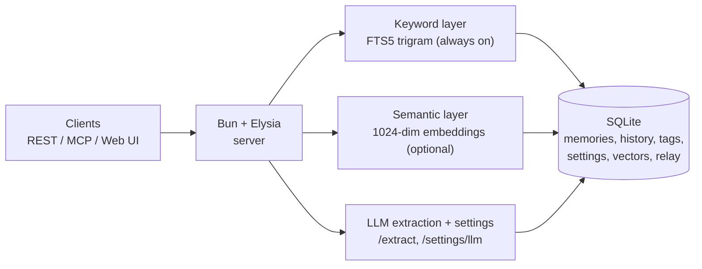

# minimem

Shared, persistent memory for AI agents: one SQLite file, one Bun process, a
REST API, an MCP endpoint, and a readable web UI. Built to answer one question:
*where does an agent put a fact so it can find it again next week?*

Finding works in two layers — keyword search is always on; semantic search is
optional and blends in when configured:



- **FTS5 trigram keyword search** — always on, no model, no network. Works for
  Thai, Chinese, Japanese and anything written without spaces (trigram: no word
  segmenter needed — ค้นหาภาษาไทยได้โดยไม่ต้องตัดคำ).
- **Optional semantic layer** — a 1024-dim multilingual embedding
  (`@cf/baai/bge-m3`) blended into the same ranking. Off unless you give it a
  key; if the provider is down it degrades to keyword-only instead of failing.
- **LLM extraction/settings** — `/extract` turns free text into memory ops;
  `/settings/llm` stores endpoint/key/models (env vars override at runtime).

## Quick start

```sh
git clone https://github.com/ktypez/minimem.git
cd minimem
bun install

mkdir -p ~/minimem-data
cat > ~/minimem.env <<'EOF'
MINIMEM_DB_PATH=$HOME/minimem-data/minimem.db
MINIMEM_TOKEN=$(head -c 32 /dev/urandom | base64 | tr -d '/+=')
HOST=127.0.0.1
PORT=3100
AUTH_ENABLED=1
EOF
chmod 600 ~/minimem.env

MINIMEM_ENV=~/minimem.env ./run.sh
curl -s localhost:3100/health
```

Open `http://127.0.0.1:3100/` and paste the token when asked.

## See full docs

- API reference (every endpoint, shapes, auth, LLM settings, deployment):
  [docs/API.md](docs/API.md)
- Per-client install (Claude Code, Codex, opencode, Crush, Gemini CLI, Cursor,
  Windsurf, …) and a self-install prompt: [docs/INSTALL.md](docs/INSTALL.md)
- Same-fact relation model: [docs/same-fact.md](docs/same-fact.md)

License: MIT — see [LICENSE](LICENSE).
